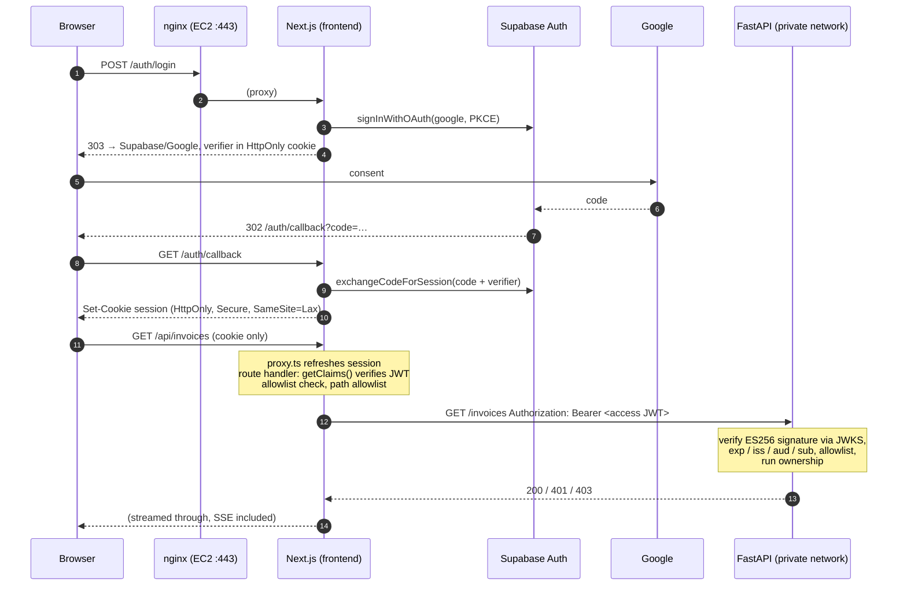

# Authentication, authorization and deployment security

Verity is a single-owner tool. Only you, and anyone you explicitly
allowlist, can sign in. Every API call is verified twice, and the backend
is never reachable from the internet. This document covers:

- the security review that motivated the changes,
- the design and the request flow,
- local setup,
- an interview-style walkthrough,
- the known limitations.

## Request flow

## Phase 1: security review (before the changes)

These findings were against the code as it stood at commit `4cd4b88`.

| # | Finding | Where | Severity | Fix |
|---|---|---|---|---|
| 1 | Every API route was unauthenticated: uploads, runs, resume, CSV export, health details | `app/routes.py` | Critical | JWT dependency on every router (`app/auth.py`) |
| 2 | Gmail endpoints were callable by anyone who could reach the backend: list the owner's mail, download attachments, mark read | `app/inbox.py` | Critical | Owner-only router dependency |
| 3 | A Gmail `id` was passed to IMAP unvalidated. `1:*` is a valid IMAP sequence set, so `POST /inbox/mark {"id":"1:*"}` would mark the **entire inbox** read, and download would fetch every message | `invoice_agent/mcp_servers/gmail_imap.py` | High | Digits-only UID check in the MCP tool itself and in the API model |
| 4 | No attachment size, count or type limits on Gmail downloads (a `.pdf` name was trusted) | `gmail_imap.py` | Medium | ≤20 MB, ≤5 per message, `%PDF-` magic bytes |
| 5 | MCP failures returned raw exception text to the client (env var names, IMAP responses) | `app/inbox.py` `call_tool` | Medium | Generic message; class name logged server-side |
| 6 | No run ownership: anyone could read, stream or resume any `thread_id`, and `GET /invoices` listed everyone's runs | `app/routes.py`, `app/service.py` | High (multi-user) | `thread_owners` table, ownership checked before any read |
| 7 | `GET /health/ready` (public) exposed configuration state and could trigger live upstream calls | `app/routes.py` | Low | Owner-only; `/health` stays public and static |
| 8 | Backend published on host port 8000, and the browser called it directly (CORS was the only "protection", and CORS doesn't stop curl) | `docker-compose.yml`, `web/lib/config.ts` | High | Backend unpublished; browser goes through the same-origin `/api` proxy; CORS removed |
| 9 | Vendor name and invoice number written into error logs and checkpoint errors | `invoice_agent/graph.py` `output()` | Low | Log `thread_id` instead |
| 10 | Internal backend URL rendered into the home page's error box | `web/app/page.tsx` | Low | Generic message |
| 11 | Concurrent MCP calls each spawn a subprocess and an IMAP login, with no bound | `app/inbox.py` | Low | Semaphore(2) |

Already in good shape, and kept as is:
- **Upload validation.** Size cap, PDF signature check and server-minted
  file paths (`app/uploads.py`).
- **Path-traversal-safe filenames** in both MCP servers and in
  `/inbox/files/{name}`.
- **Non-root images** with `.dockerignore`-excluded `.env` files.
- **Graph concurrency limit** (`GRAPH_MAX_CONCURRENCY`).
- **Sanitized error responses** (`app/errors.py`).

## Design

### Identity: Supabase Auth with Google (OAuth 2.0 / OIDC)

- **Flow.** Login is the PKCE authorization-code flow, started and finished
  **server-side** (`web/app/auth/login/route.ts`,
  `web/app/auth/callback/route.ts`). The app has no browser Supabase client
  at all.
- **Cookies.** Session cookies are forced to `HttpOnly`, `Secure` (in
  production) and `SameSite=Lax` (`web/lib/supabase/env.ts`
  `COOKIE_FLAGS`). `@supabase/ssr` defaults to script-readable cookies and
  ignores its `cookieOptions` for the PKCE verifier, so the flags are applied
  in `setAll` itself. No token ever touches `localStorage`.
- **Refresh.** `web/proxy.ts` (Next 16's renamed middleware) refreshes
  expiring sessions on every request and redirects anonymous users to
  `/login`.
- **Sign-out** is a `POST` (not a GET link), which revokes the refresh
  token.
- **Redirect target.** The callback always lands on `/`. There's no
  caller-supplied redirect, so there's no open redirect.
- **Sign-up** is disabled in Supabase, and the app allowlists user IDs on
  top of that (`OWNER_USER_ID`, `ALLOWED_USER_IDS`). If unset, nobody gets
  in (fail closed).

### API authentication: asymmetric JWT verification, twice

1. **Next.js** (`web/app/api/[...path]/route.ts`):
   - `getClaims()` verifies the access token's signature against the
     project's JWKS. Unlike `getSession()`, it doesn't just trust the
     cookie.
   - It then checks the allowlist and forwards **only** the token as
     `Authorization: Bearer`.
   - No user-ID header is ever sent.
   - A method + path allowlist means only the endpoints the UI uses are
     reachable (`/health/ready` and `/docs` aren't).
2. **FastAPI** (`app/auth.py`) trusts nothing from the proxy:
   - It fetches `{SUPABASE_URL}/auth/v1/.well-known/jwks.json` through
     PyJWT's `PyJWKClient`, cached, and refetched on an unknown `kid`, so
     key rotation works.
   - Signature algorithms are **ES256/RS256 only**, so `none` and `HS256`
     forgeries are rejected.
   - It requires `exp`, `iat`, `sub`, `iss` == `{SUPABASE_URL}/auth/v1` and
     `aud` == `authenticated`.
   - Identity is the verified `sub` claim, nothing else.
   - A JWKS outage is a 503, not a 401, so an outage doesn't look like a
     logout.

### Authorization

| Endpoint group | Who |
|---|---|
| `GET /health` | anyone (static `{"status":"ok"}`, for Docker) |
| `GET /health/ready` | owner |
| upload, reserve, list, detail, stream, resume | any allowlisted user, **own runs only** |
| `/export.csv`, `/export/status` (the shared ledger) | owner |
| `/inbox*` (Gmail and the local folder) | owner |

- **Ownership.** `app/owners.py` records `thread_id → user_id` in the
  checkpoint SQLite file, when a thread is reserved or created.
- **Checks.** Every per-run route checks ownership before reading anything.
  `GET /invoices` filters to the caller's runs.
- **Legacy runs.** Threads created before this change have no owner row and
  belong to `OWNER_USER_ID`.
- **Unknown threads.** An unknown thread is a 403 for non-owners, the same
  as someone else's, so IDs can't be probed.
- **Status codes.** 401 = no or invalid token, 403 = valid token without
  permission. Bodies are fixed strings that never echo the token or the
  verification detail.

### SSE through the proxy

`EventSource` can't set headers. Because the browser opens
`/api/invoices/{id}/stream` on its own origin, the HttpOnly cookie rides
along. The route handler turns it into a Bearer header and streams the
upstream body back unbuffered:
- `compress: false` in `next.config.ts`;
- `X-Accel-Buffering: no` on the response;
- `proxy_buffering off` on the nginx stream location.

The SSE stream never carries a token in its URL.

### Gmail (owner only)

- **Credentials.** IMAP and the App Password stay in the backend container
  only. The frontend container doesn't even receive them.
- **Validation.** IDs are single numeric UIDs (validated in both
  `app/inbox.py` and the MCP tool, since MCP tools can be called without
  HTTP). Filesystem IDs are bare `.pdf` names.
- **Limits.**
  - Listing is capped at 25.
  - Attachments must be real PDFs (`%PDF-`), at most 20 MB, with at most 5
    per message. Listing and download use the same filter, so they agree.
- **Fixed search.** The search is fixed (`is:unread has:attachment
  filename:pdf`). No caller-supplied query or IMAP command reaches the
  server.
- **Behaviour.** The unread filter, PDF selection, BODY.PEEK (download
  doesn't mark as read) and explicit mark-processed are unchanged.

### Untrusted content (prompt injection)

Email subjects, filenames and PDF contents are attacker-controllable. What
limits the damage:
1. **The model can't act.** The extractor is a single structured-output
   call with no tools, so injected instructions can't trigger actions;
   they can at most distort extracted fields.
2. **Validation is deterministic.** Totals math, dates and duplicates are
   checked in plain Python (`invoice_agent/validate.py`), so a "this
   invoice is valid" instruction can't skip checks.
3. **Humans approve flagged invoices.** Flagged invoices need human review
   before reaching the ledger.
4. **Gmail actions are API-only.** The Gmail MCP tools are never exposed to
   the LLM, only called by the API on the owner's request.
5. **Outputs are treated as data.** Extracted text is rendered as text by
   React (escaped), never as HTML.

### Migrating Gmail to per-user OAuth (not implemented)

Today one App Password reads one mailbox, which is why Gmail is owner-only.
For multiple users:
1. Request the `gmail.readonly` + `gmail.modify` scopes through Google
   OAuth (Supabase can return `provider_token`/`provider_refresh_token`, or
   use a separate Google OAuth client).
2. Store each user's refresh token **encrypted** server-side (KMS or
   Supabase Vault), keyed by the Supabase `sub`.
3. Switch the MCP server from IMAP to the Gmail REST API (or IMAP
   XOAUTH2), with the access token passed per call.
4. Scope every inbox endpoint to `user.id`'s token; downloaded files go
   under a per-user directory.
5. Pass Google's OAuth app verification for restricted Gmail scopes. That
   takes weeks and needs a security assessment, which is why a single-owner
   App Password is the pragmatic choice for a demo.

## Local development

1. Backend `.env`: `SUPABASE_URL`, `OWNER_USER_ID`, plus the existing keys
   (see `.env.example`).
2. `web/.env.local`: `SUPABASE_URL`, `SUPABASE_PUBLISHABLE_KEY`,
   `OWNER_USER_ID` (see `web/.env.example`).
3. Supabase → Authentication → URL Configuration: add
   `http://localhost:3000/auth/callback` (and your dev port, if different)
   to the redirect URLs.
4. Run `uvicorn app.main:app --reload` and `cd web && npm run dev`, then
   sign in.
5. First sign-in with `OWNER_USER_ID` unset shows "doesn't have access"
   along with **your user ID**. Put it in both env files, restart, and sign
   in again.

`AUTH_DISABLED=true` skips verification on the backend for tests and
scripts. It logs a warning at startup and must never be set in production.

Tests: `tests/test_auth.py` signs real ES256 JWTs with a throwaway key
pair. It covers:
- missing, malformed, expired, wrong-issuer, wrong-audience, wrong-key,
  `alg:none` and HS256 tokens;
- spoofed identity headers;
- non-allowlisted users;
- cross-user run access and listing;
- export and Gmail as anonymous, other user and owner;
- the JWKS outage case;
- no token or detail echo in responses.

## Interview walkthrough

> "Authentication is Google OIDC through Supabase Auth, using the PKCE
> code flow run server-side in Next.js. The session lives in HttpOnly,
> Secure, SameSite=Lax cookies, so no JavaScript can read a token.
>
> The browser only talks to the Next.js origin. A route handler there
> verifies the session, checks an allowlist, and forwards the user's access
> token as a Bearer header to FastAPI, which sits on a private Docker
> network. FastAPI doesn't trust that hop. It verifies the JWT itself
> against Supabase's JWKS: asymmetric ES256 only, with exp, iss, aud and
> sub enforced. Then it authorizes: an allowlist, owner-only routes for
> Gmail and the ledger, and per-run ownership so users can't read each
> other's runs.
>
> The same-origin proxy also solves EventSource's no-headers limitation,
> and it removes CORS entirely.
>
> On AWS it's one EC2 box: nginx terminates TLS with HSTS and rate limits;
> only 443 and 80 are open, and admin access goes through SSM, not SSH.
> Secrets live in Secrets Manager. The instance role reads them at boot into
> a root-only file, so there are no AWS keys anywhere. Docker keeps the
> container env in root-only config on the encrypted disk, so root on the
> box is the trust boundary. Images are built in CI and pinned by commit
> SHA. Deploys are keyless: GitHub's OIDC token assumes a role that trusts
> only this repo's approval-gated `production` environment, and that role
> can only send one SSM document to one instance. The document runs a
> deploy script with a validated SHA, which health-checks the new version
> and rolls back automatically. The checkpoint DB is backed up nightly to
> S3 with a 30-day lifecycle."

Trade-offs worth naming:
- **Two JWT verifications per request** (cheap: the JWKS is cached) in
  exchange for defense in depth.
- **A SQLite ownership table** rather than Postgres RLS: run state already
  lives in that SQLite file.
- **A single instance**, not ECS/ALB: the right size for a single-owner
  tool.

## Limitations

- **Single EC2 instance** with SQLite checkpoints: no HA, and deploys have
  seconds of downtime.
- **Rate limiting is per-IP in nginx.** There's no WAF, and no per-user
  quotas.
- **The ledger (CSV export) is global**, hence owner-only. Allowlisted
  non-owners can process invoices, but rows still land in the one shared
  Supabase ledger.
- **Gmail is the owner's mailbox only** (App Password). See the migration
  section above.
- **The access token lives up to Supabase's JWT expiry** (default 1 hour)
  after sign-out. Sign-out revokes the refresh token, but an
  already-issued access JWT stays valid until `exp`. Stateless JWTs work
  this way; shorten the expiry in Supabase if that matters.
- **The Google sign-in flow was verified up to the Google consent
  redirect** in this environment. Completing a real Google login, and the
  AWS deployment itself, need your accounts and haven't been run by the
  author.
